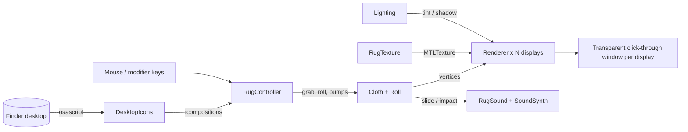

# Architecture

Kilim is a single‑target SwiftPM executable (`Sources/Kilim`) built with **system frameworks only**
(AppKit, MetalKit, CoreGraphics/CoreText, AVFoundation, ServiceManagement).

## Modules

| Folder | Responsibility |
|---|---|
| `App/` | `RugController` – the glue: status‑bar menu, one `Overlay` (window + `RugView` + `Renderer`) per display, mouse/modifier handling, peek, icon‑drag following, the frame loop |
| `Simulation/` | `Cloth` – the physics. `Roll` – kinematic roll/unroll pose that temporarily takes over from physics |
| `Rendering/` | `Renderer` – Metal pipeline and shader (compiled at runtime from a string). `RugTexture` – procedural patterns. `Lighting` – sun model |
| `Audio/` | `SoundSynth` – real‑time procedural audio. `ThumpDetector` – decides when an impact deserves a thump |
| `Desktop/` | `DesktopIcons` – asks Finder for icon positions on a background queue |
| `Localization/` | `Lang`, `Str`, `L10n` – 21 languages, theme names, menu ordering and validation |
| `Diagnostics/` | Headless modes used by developers (`--selftest`, `--texture`, `--langtest`, `--audiotest`, `--custom`, `--icon`) |

## Coordinate spaces

- **Finder space** – primary display top‑left origin, y down (what `osascript` reports).
- **Cloth space** – the union of all displays in Finder coordinates, shifted by `unionOrigin` so that it starts at (0, 0).
  The rug is one continuous cloth across every monitor; each `Overlay` renders the slice that falls on its display
  (a per‑display `offset` uniform + scissor rectangle).
- When the display configuration changes, overlays are rebuilt and the cloth is translated so it stays where it was.

## Cloth simulation

- 44 × 30 particles, structural + shear + bend constraints, solved by position‑based dynamics (≈22 iterations per step,
  constraints are graph‑coloured and sorted so each batch touches every particle at most once).
- Verlet integration with damping, gravity, Coulomb‑style friction against the desktop, and self‑collision.
- **Bumps** – icon positions become a smooth height field; particles ride on top of it, which is what makes icons appear as bumps.
- **Grabbing** – the nearest particles are pinned to the cursor (limited step per frame so flicks stay tame) and lifted by `liftH`.
- **Sleeping** – when kinetic energy stays below a threshold the cloth is marked `settled`; the render loop and display links pause until something wakes it.
- **Roll** – `rollP` ∈ [0, 1] drives a spiral pose (r(s) = r₀ + t·θ/2π). While `rollActive`, `step()` evaluates the pose instead of physics, and hands back to physics once fully unrolled.

## Rendering

- One `MTKView` per display, transparent and `ignoresMouseEvents` when peeking or when the cursor is not over the rug.
- Uniforms: view size, cloth centre, perspective strength `K`, texel size, display offset, alpha (peek fade), light, tint and shadow.
- Lifted parts of the cloth are shifted away from the centre (cheap perspective) and a soft shadow is drawn underneath.
- Textures are painted with CoreGraphics at 1536 × 1032, quantised palettes per theme, plus woven‑look noise and fringe.

## Peek mode

A 20 Hz timer polls `NSEvent.modifierFlags` for the configured key. While held (or while a mouse button is pressed after
the key was held – so Finder's ⌥‑copy semantics do not trigger mid‑drag), all windows ignore the mouse and fade to alpha 0.26.

## Audio

`SoundSynth` renders on the audio thread from a few shared parameters (rustle level, thump trigger, volume):
band‑passed noise with slow shallow grain for rustling, and a decaying sine/noise burst for thumps.
`ThumpDetector` filters physics impacts (start/total thresholds, cooldown, rate limit, suppression while carrying).

## Localization

Strings are positional arrays in `L10n.table`, indexed by the `Str` enum. `L10n.validate()` (run via `--langtest` and `make test`)
checks that every language provides every string. The system language is used by default and the user can override it in the menu.

## Testing

There is no XCTest target because the project targets machines with only the Command Line Tools. Instead `Scripts/test.sh` builds
the app and runs the headless diagnostics: language completeness, audio numerics (no NaNs), and a physics/render scenario
suite that writes PNGs (`--selftest`) which can be inspected by eye or diffed.
