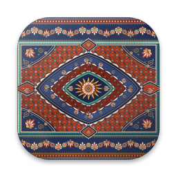
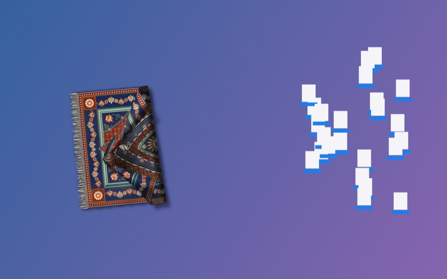
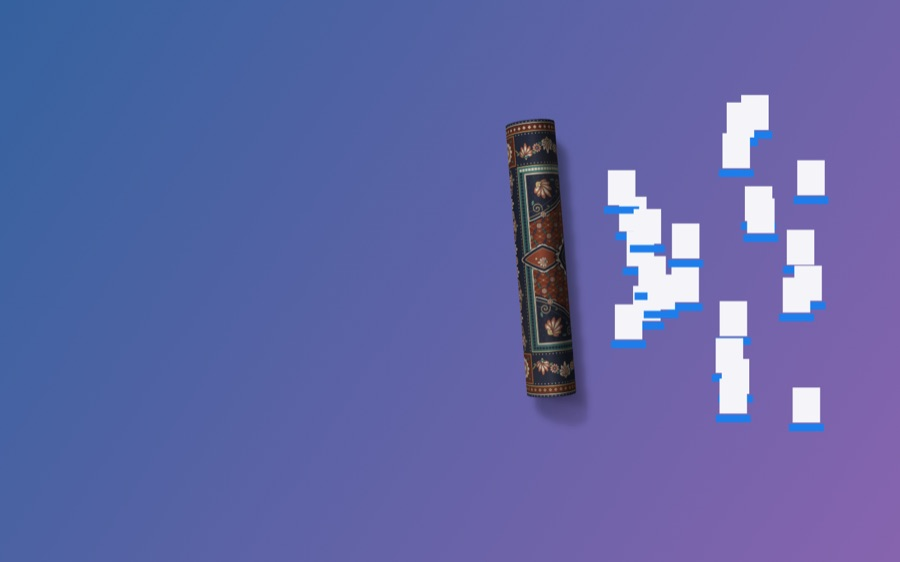
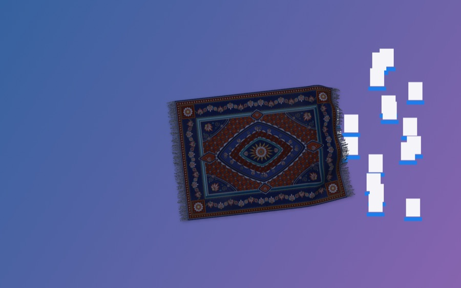
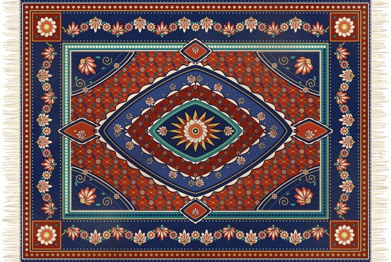
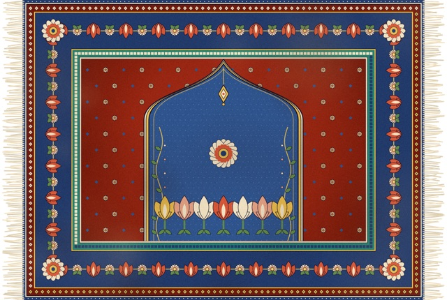
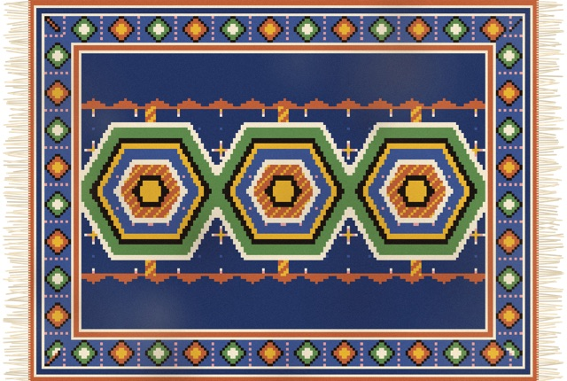
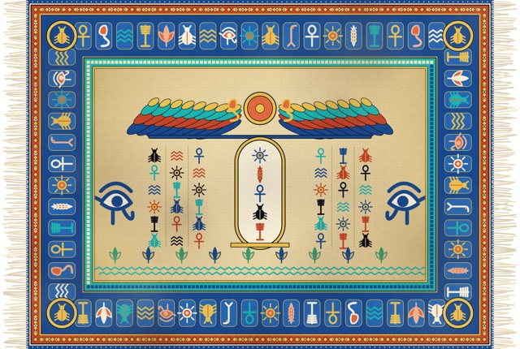
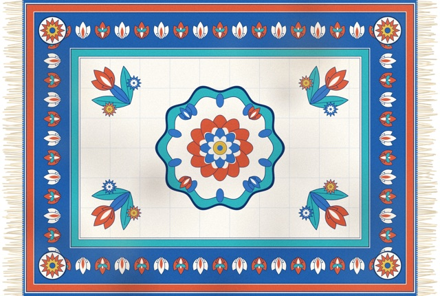

<div dir="rtl">

<div align="center">



# Kilim

**فرشی با فیزیک پارچه برای دسکتاپ macOS شما.**
بکشیدش، تا کنید، لوله‌اش کنید – و آیکون‌های شلوغ دسکتاپ را زیرش جارو کنید.

[](../../LICENSE)

[](https://github.com/sponsors/yusufyilmazfr)

[دانلود آخرین نسخه](https://github.com/yusufyilmazfr/kilim/releases/latest)

[Türkçe](README.tr.md) · [English](../../README.md) · [Kurdî](README.ku.md) · [Español](README.es.md) · [Français](README.fr.md) · [Deutsch](README.de.md) · [Português](README.pt.md) · [Italiano](README.it.md) · [Nederlands](README.nl.md) · [Polski](README.pl.md) · [Русский](README.ru.md) · [中文](README.zh.md) · [日本語](README.ja.md) · [한국어](README.ko.md) · [हिन्दी](README.hi.md) · [বাংলা](README.bn.md) · [العربية](README.ar.md) · **فارسی** · [اردو](README.ur.md) · [Bahasa Indonesia](README.id.md) · [Tiếng Việt](README.vi.md)

  

</div>

---

## ویژگی‌ها

- **فیزیک واقعی پارچه** – فرش را بگیرید، بکشید، تا کنید و پرتاب کنید.
- **آیکون‌های دسکتاپ را پنهان می‌کند** – جای آیکون‌ها برجستگی ایجاد می‌شود و هنگام کشیدن آیکون، برجستگی هم دنبالش می‌آید.
- **حالت نگاه‌کردن** – ⌥ Option (قابل تغییر) را نگه دارید: فرش شفاف می‌شود و می‌توانید روی آیکون‌ها کلیک کنید.
- **لوله‌کردن** – با دوبار کلیک فرش لوله می‌شود و با دوبار کلیک دوباره باز می‌شود.
- **۱۶ طرح** – ایرانی، ترکی، کردی، مصری، بربر، قزاق، چینی، ایاصوفیه، ازنیک، سلجوقی… و **عکس خودتان** که به‌صورت فرش بافته می‌شود.
- **نور روز و شب** – رنگ و سایه با ساعت روز تغییر می‌کنند.
- صدای خش‌خش و برخورد تولیدشده با کد (بدون فایل صوتی)، چندین نمایشگر، ۲۱ زبان.
- سبک و خصوصی: بدون دسترسی به شبکه، بدون تحلیل داده.

## طرح‌های فرش

همهٔ طرح‌ها هنگام اجرا با کد نقاشی می‌شوند و هیچ تصویر آماده‌ای در بسته نیست. با **فرش من…** هر عکسی را می‌توانید به فرشی حاشیه‌دار تبدیل کنید.

<div align="center">
    
</div>

## نصب

```sh
curl -fsSL https://raw.githubusercontent.com/yusufyilmazfr/kilim/main/Scripts/install.sh | bash
```

1. فایل `Kilim-<نسخه>.zip` را از [Releases](https://github.com/yusufyilmazfr/kilim/releases/latest) دانلود کنید.
2. آن را از حالت فشرده خارج کنید و **Kilim.app** را به پوشهٔ `Applications` بکشید.
3. بار اول **راست‌کلیک ← Open** کنید (برنامه نوتاریزه نیست) یا این دستور را اجرا کنید: `xattr -dr com.apple.quarantine /Applications/Kilim.app`
4. Kilim در نوار منو اجرا می‌شود (بدون آیکون Dock). اگر macOS اجازهٔ کنترل **Finder** را خواست، **OK** بزنید – فقط برای خواندن جای آیکون‌ها استفاده می‌شود.

برای ساخت از روی سورس، macOS 13+ و Xcode Command Line Tools کافی است:

```sh
git clone https://github.com/yusufyilmazfr/kilim.git
cd kilim
make run
```

## طرز استفاده

| کنش | نتیجه |
|---|---|
| کشیدن فرش | گرفتن، حمل یا تا کردن |
| دوبار کلیک | لوله کردن / باز کردن |
| نگه‌داشتن ⌥ Option | نگاه‌کردن: فرش شفاف و کلیک‌ها به آیکون‌ها می‌رسند |
| انداختن تصویر روی آیکون نوار منو | بافتن فرش خودتان |
| آیکون نوار منو | طرح، نور، صدا، زبان، اجرا هنگام ورود، کلید نگاه‌کردن |

## حریم خصوصی و مجوزها

- بدون دسترسی به شبکه، بدون تله‌متری، بدون حساب کاربری.
- مجوز **Automation ← Finder** فقط برای خواندن جای آیکون‌هاست؛ بدون آن فرش کار می‌کند ولی برجستگی‌ها نمایش داده نمی‌شوند.
- تصویر فرش شخصی شما فقط روی دستگاه خودتان ذخیره می‌شود (`~/Library/Application Support/Kilim/`).

## پشتیبانی

- گزارش اشکال و پیشنهاد: [Issues](https://github.com/yusufyilmazfr/kilim/issues/new/choose)
- پرسش و ایده: [Discussions](https://github.com/yusufyilmazfr/kilim/discussions)
- Kilim رایگان است. اگر دوستش داشتید از طریق [GitHub Sponsors](https://github.com/sponsors/yusufyilmazfr) حمایت کنید.
- ستاره دادن به مخزن هم خیلی کمک می‌کند!

## مشارکت

طرح‌ها، ترجمه‌ها و رفع اشکال‌های جدید خوش‌آمدند. ابتدا [CONTRIBUTING.md](../../CONTRIBUTING.md) (انگلیسی) را بخوانید.

## مجوز

[MIT](../../LICENSE) © 2026 Yusuf Yılmaz

---

<sub>برای رفع مشکل، معماری و نقشهٔ راه به [README انگلیسی](../../README.md) مراجعه کنید.</sub>

</div>
